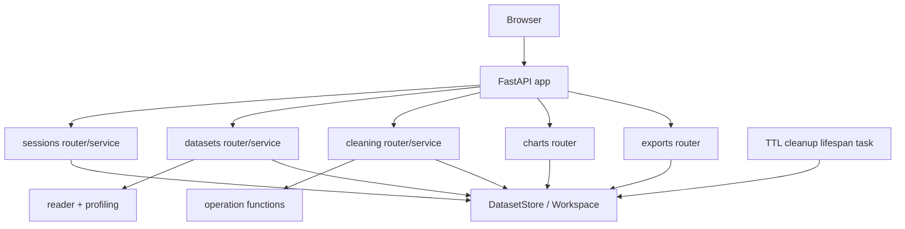

# Backend architecture

## Layer map

```text
app/main.py
  ├── core/                 Settings, credential dependency, error helpers
  ├── modules/sessions/     Create and end temporary guest workspaces
  ├── modules/datasets/     Upload parsing, profiling, paginated rows
  ├── modules/cleaning/     Preview/apply, operations, history, Undo/Reset
  ├── modules/charts/       Revision-scoped chart aggregates
  ├── modules/exports/      CSV, XLSX and PDF streaming responses
  ├── infrastructure/      In-memory registry, locks, TTL cleanup
  └── shared/              Common dependencies and pagination models
```

The `templates`, `validation`, and `ml` module directories are reserved extension points. Their blueprint features are not active API routes yet.

## Dependency direction

- `main.py` wires routers, CORS and app lifespan.
- Routers define HTTP paths, request parsing, dependency injection and status-code mapping.
- Services coordinate domain behavior such as dataset lookup, revision checks, profile generation, transformations and exports.
- Cleaning operation modules contain DataFrame transformations and do not own HTTP routing.
- Infrastructure owns temporary state and cleanup. Core settings/security can be used by routers and services.
- Schemas define request/response shapes; shared utilities are cross-module helpers.



## Dataset state boundaries

`DatasetStore` is the MVP repository. `Workspace` is the ownership/session boundary; `DatasetState` is the revision boundary. Every dataset lookup requires a workspace token. Current and original frames are separate copies. Mutating services acquire a dataset lock and replace `current` only after the new DataFrame has been produced successfully.

The registry is process-local. Do not start multiple workers or replicas expecting shared sessions. Restarting a process discards the registry. A future repository adapter should preserve the same ownership, TTL and revision contracts while moving temporary state to coordinated storage.

## API composition

All routes are mounted under `/api/v1`, with `/health` outside that prefix. The OpenAPI document at `/docs` is generated from FastAPI schemas and router declarations. CORS origins are environment-configured. The browser sends the opaque credential in `X-Workspace-Token`; this is an MVP transport choice, not a replacement for HTTPS.

See [API](API.md) for endpoint contracts, [business logic](BUSINESS_LOGIC.md) for operation rules, and [system design](SYSTEM_DESIGN.md) for lifecycle, security boundaries and scaling.
