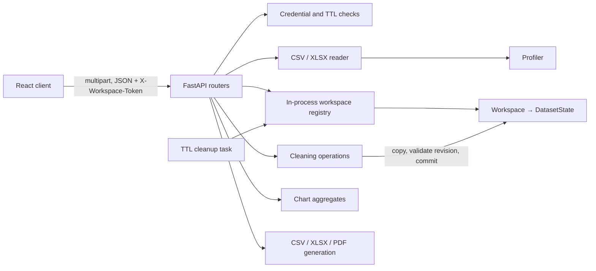

# Backend system design

## Goals

- Let a guest use the service without creating an account.
- Keep a dataset private to the workspace credential that owns it.
- Retain an unchanged original and a revisioned working copy during a short session.
- Preview complete-operation impact without committing changes.
- Bound file size and shape, and return only paginated rows to the browser.
- Generate exports from a revision-checked snapshot.

## Runtime components

## State model

`Workspace` contains a UUID-like `session_id`, an opaque token, display name, last activity and a map of datasets. `DatasetState` contains the dataset ID/name, original DataFrame, current DataFrame, revision number, previous-frame snapshots, operation records, creation time and a mutation lock.

The registry and DataFrames are held in a Python process. This supports a single-process MVP only. State is lost on restart; another worker cannot see these workspaces. The cleanup coroutine removes expired registry entries. Current export responses are streamed directly and are not retained as session files.

## Request lifecycle

### Upload

1. Authenticate the workspace credential.
2. Check file extension/size and parse CSV or the requested workbook sheet.
3. Normalize headers and enforce row/column caps.
4. Store an original copy plus revision-zero working copy in the owning workspace.
5. Return dataset identity and dimensions.

### Mutation

1. Authenticate dataset ownership and acquire its mutation lock.
2. Compare `expected_revision` with the current revision.
3. Transform a deep copy and validate that a non-empty dataset remains.
4. If applying, save the old current frame, swap in the result, append an operation record and increment revision.
5. Release the lock. On error, leave current state unchanged.

Preview follows the same ownership, lock and revision checks but does not save or replace state.

### Chart/export

Check the requested revision while holding the dataset lock and take a copy of the current frame. Perform chart aggregation or export from that snapshot, then return a response/stream. A revision mismatch returns `409`.

## Trust boundaries and privacy

- Treat uploaded files, worksheet names, column names, cell values, operation parameters and requested formats as untrusted input.
- Never execute workbook formulas, macros or uploaded code.
- Require the workspace token on all session-owned dataset access; do not rely on opaque IDs as authorization.
- Avoid logging cell values or credential values.
- Escape formula-like text when exporting CSV/XLSX while keeping numeric data numeric.
- Expire in-memory state after inactivity and delete it on End Session.
- Use HTTPS and a protected credential transport in deployment. The current browser MVP stores its token in session storage; an HttpOnly cookie or equivalent is preferable for a production threat model.

## Failure and concurrency behavior

Invalid file/configuration requests return client errors. Stale revisions return `409`; expired sessions return `410`. Mutations are synchronous and use a per-dataset lock. Upload parsing, profiling, chart generation and PDF rendering execute inline; no cancellation/job queue exists. Configure conservative limits and run one backend process while using the process-local registry.

## Scaling path

To run multiple workers, replace the process-local registry with shared temporary storage and coordinate ownership, revision updates, TTL expiry and cleanup. For long-running work, introduce job records, a queue, progress/cancellation, and credential-protected downloads. Keep original datasets and derived artifacts in private temporary storage with explicit expiry. Add monitoring for parse failures, operation duration, memory, export failures and cleanup outcomes. Do not silently extend TTL when reusing exports.
